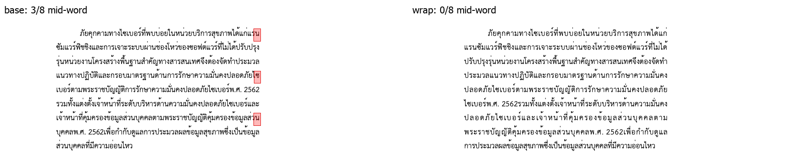

# thai-docs-skills

ชุด skill สำหรับเอกสาร Word ภาษาไทย ตอนนี้มี skill แรกคือ **`thai-docx`**: จัดหน้า Word ไทยให้ถูกหลัก
และตัดคำไม่ให้ขาดกลางคำเมื่อขึ้นบรรทัดใหม่ ใช้ได้กับ Claude Code, claude.ai, Codex และ Antigravity

## ทำอะไรได้

- `fix` จัดหน้าทั้งไฟล์: ฟอนต์ TH Sarabun New ทั้งเล่ม ขนาดอักษรไทย-อังกฤษเท่ากัน ติดป้ายภาษาไทยทุก run
  (เส้นหยักแดงหาย) แก้อักษรเพี้ยน หัวข้อไม่ค้างท้ายหน้า ระยะบรรทัดเดี่ยว ระยะก่อนย่อหน้า 6 pt ตามชนิดเอกสาร (`--doc ราชการ|รายงาน`) เลขไทย กระจายแบบไทย (เลือกได้)
- `check` ตรวจไฟล์ก่อนส่ง/พิมพ์โดยไม่แก้ไฟล์
- `wrap` / `unwrap` ตัดคำล่วงหน้าเพื่อให้ Word ขึ้นบรรทัดใหม่เฉพาะระหว่างคำ
- `segment` ดูผลตัดคำไว้ตรวจหรือเพิ่มคำเอง
- สคริปต์ไม่เรียก AI หรือเครือข่ายใดๆ ทำงานกับไฟล์ในเครื่อง



ผลวัดใน Word for Mac: ข้อความทดสอบ 10 ย่อหน้า × ความกว้างหน้า 7 ขนาด Word ตัดเองขึ้นบรรทัดกลางคำ
**10.9%** ของจุดขึ้นบรรทัด หลัง `wrap` เหลือ **0.2%** (การทดลองแรก 4 ย่อหน้า: 12.8% → 2.0%)

> ตัวเลข 0.2% วัดกับข้อความทดสอบที่คำเฉพาะอยู่ในพจนานุกรมแล้ว ข้อความที่มีคำเฉพาะที่พจนานุกรมไม่มีอาจได้ผลด้อยกว่านี้
> เมื่อวัดตัวตัดคำกับข้อความที่ไม่เคยเห็น ผิดขอบเขตคำราว 3.6% เมื่อมี khammoon และราว 7.1% เมื่อใช้พจนานุกรมอย่างเดียว

## ติดตั้ง

ต้องมี Python 3.10 ขึ้นไป และ `python-docx`, `lxml` (เสริม `numpy` สำหรับตัวตัดคำ khammoon) คำสั่งจะบอกวิธีติดตั้งเองถ้าขาด
แพ็กเกจ: `pip install python-docx lxml numpy`

| ที่ใช้ | วิธี | แหล่งอ้างอิง |
|---|---|---|
| **Claude Code** | `/plugin marketplace add Pitarat1/thai-docs-skills` แล้ว `/plugin install thai-docs@thai-docs-skills` (หรือจากเทอร์มินัล: `claude plugin install thai-docs --marketplace Pitarat1/thai-docs-skills` ต้อง v2.1.292 ขึ้นไป) | [Install and manage plugins](https://code.claude.com/docs/en/discover-plugins) |
| **claude.ai** | ดาวน์โหลด `thai-docx.zip` จาก Releases แล้วไป Customize > Skills > ปุ่ม + > Create skill > Upload a skill ต้องเปิด Code execution (Settings > Capabilities) ขนาด zip สูงสุด: **ยังไม่ได้ยืนยัน** (เอกสารระบุแต่ว่าเกินขนาดที่กำหนดจะอัปโหลดไม่ได้ ไม่ระบุตัวเลข; `thai-docx.zip` ≈ 4.2 MB, `thai-docx-nokhammoon.zip` ≈ 0.5 MB) | [Use skills in Claude](https://support.claude.com/en/articles/12512180-use-skills-in-claude) |
| **Codex** | คัดลอกโฟลเดอร์ `thai-docx` (จาก zip หรือ `plugins/thai-docs/skills/thai-docx`) ไปไว้ที่ `$HOME/.agents/skills/` (ใช้ทุก repo) หรือ `<repo>/.agents/skills/` (เฉพาะ repo) | [Codex: build skills](https://learn.chatgpt.com/docs/build-skills) (developers.openai.com/codex/skills ส่งต่อมาที่นี่) |
| **Antigravity** | คัดลอกโฟลเดอร์ `thai-docx` ไปไว้ที่ `~/.gemini/config/skills/` (ทั้งเครื่อง) หรือ `<workspace>/.agents/skills/` (เฉพาะโปรเจกต์) เอกสารระบุว่ายังรองรับ `.agent/skills` แบบเดิมและ `~/.gemini/antigravity/skills/` ของ IDE แบบเดิม | [Antigravity: Agent skills](https://antigravity.google/docs/skills/) |

หมายเหตุ: โฟลเดอร์ skill ต้องชื่อ `thai-docx` ตรงกับชื่อใน SKILL.md (zip ที่แจกจัดไว้ให้แล้ว)

## คำสั่งที่ใช้บ่อย

รันในโฟลเดอร์ที่มีไฟล์ .docx ของคุณ `<โฟลเดอร์ skill>` คือโฟลเดอร์ที่มี SKILL.md

```bash
python "<โฟลเดอร์ skill>/scripts/thaidocx.py" check ไฟล์.docx
python "<โฟลเดอร์ skill>/scripts/thaidocx.py" fix ไฟล์.docx ไฟล์_v2.docx
python "<โฟลเดอร์ skill>/scripts/thaidocx.py" fix ไฟล์.docx ไฟล์_v2.docx --doc ราชการ --thai-digits --distribute --wrap-words
python "<โฟลเดอร์ skill>/scripts/thaidocx.py" wrap ไฟล์_v2.docx ไฟล์_v3.docx
python "<โฟลเดอร์ skill>/scripts/thaidocx.py" unwrap ไฟล์_v3.docx ไฟล์_แก้ต่อ.docx
python "<โฟลเดอร์ skill>/scripts/thaidocx.py" segment "อำเภอวังน้ำเย็นจังหวัดสระแก้ว"
```

ไฟล์ปลายทางต้องเป็นคนละไฟล์กับต้นทาง (ไม่เขียนทับ) และคำสั่งปฏิเสธถ้าไฟล์ยังเปิดใน Word อยู่
ในแชทกับ AI พูดได้เลย เช่น "จัดไฟล์ report.docx ให้ตัดคำไม่ขาดกลางคำ แล้วบันทึกเป็น report_v2.docx"
รายละเอียดทุกคำสั่งและตัวเลือกอยู่ใน `plugins/thai-docs/skills/thai-docx/SKILL.md`

## ข้อแลกเปลี่ยนของ wrap

1. เป็นขั้น **สุดท้ายก่อนส่ง/พิมพ์** ข้อความที่พิมพ์เพิ่มภายหลังจะไม่ได้ป้ายไทย ให้ `unwrap` ก่อนแก้ แล้ว `wrap` ใหม่
2. เส้นตรวจคำสะกดต้องซ่อน (`fix` ทำให้อัตโนมัติ) เพราะ Word จะมองคำไทยเป็นภาษาอังกฤษ
3. ค้นหาคำเดียวใน Word เจอ แต่ค้นวลีที่ข้ามคำอาจไม่เจอเพราะมี ZWSP (ตัวอักษรความกว้างศูนย์) คั่น และข้อความที่คัดลอกออกไปจะติด ZWSP ไปด้วย
4. ไม่ใช่ค่าเริ่มต้นของ `fix` ต้องสั่ง `--wrap-words` หรือใช้ `wrap` เอง
5. ถ้าเปิดปุ่มแสดงเครื่องหมายจัดรูปแบบ (¶) ใน Word for Windows จะเห็นกล่องเล็ก □ ระหว่างคำไทย นั่นคือ ZWSP ปิดปุ่ม ¶ (Ctrl+Shift+8) แล้วจะหายไป และไม่ติดไปตอนพิมพ์

## ทดสอบกับ

| โปรแกรม | สถานะ |
|---|---|
| Word for Mac | ผ่าน: ตัดกลางคำ 10.9% → 0.2% (ข้อความทดสอบ 10 ย่อหน้า × 7 ความกว้าง) |
| Word for Windows | ผ่าน: ทีมผู้ใช้ทำรายงานการประชุมจริงด้วย claude.ai แล้วเปิดดู ตัดคำถูก (ยังไม่ได้วัดเป็นตัวเลข) |
| LibreOffice | รอตรวจ |

การใช้งานจริงกับ AI แต่ละตัว:

| ตัวแทน | สถานะ |
|---|---|
| Claude Code (`claude plugin validate`, `claude -p --plugin-dir`) | `claude plugin validate` ผ่านทั้ง marketplace และ plugin (เตือนเรื่องไอคอนเท่านั้น); การสั่งงานจริงแบบ headless **ยังไม่ได้ทดสอบ** (CLI ในเครื่องผู้พัฒนายังไม่ได้ล็อกอิน: Not logged in) |
| Codex | ยังไม่ได้ทดสอบ (ไม่มี CLI ในเครื่องผู้พัฒนา) |
| Antigravity | ยังไม่ได้ทดสอบ (ไม่มี CLI ในเครื่องผู้พัฒนา) |
| claude.ai | ยังไม่ได้ทดสอบ (ยังไม่ได้อัปโหลดจริง) |

## สัญญาอนุญาต

| ส่วน | สัญญาอนุญาต |
|---|---|
| โค้ดของ repo | Apache-2.0 (ไฟล์ `LICENSE`) |
| ส่วนที่มาจาก SARABUN.AI (กปภ.) | Apache-2.0 คง NOTICE เดิม ไม่รวมตราและโลโก้ของหน่วยงาน |
| newmm / TCC จาก PyThaiNLP | Apache-2.0 |
| รายการคำทั่วไป (`words_th.txt` จาก PyThaiNLP) | CC0-1.0 (ตาม NOTICE) |
| รายชื่อคน/นามสกุล (thai-names-corpus) | CC BY-SA 4.0 |
| ชื่อสถานที่ (กรมการปกครอง ผ่าน data.go.th) | "Open Data Common" **ยังตรวจข้อความเต็มของสัญญาไม่ได้** ว่าแจกจ่ายต่อ/ใช้เชิงพาณิชย์ได้หรือไม่ |
| khammoon โค้ด | Apache-2.0 |
| khammoon โมเดล `weights.npz` | **CC BY-NC-SA 4.0 ห้ามใช้เชิงพาณิชย์** |

**ใช้เชิงพาณิชย์:** ใช้ `thai-docx-nokhammoon.zip` (ไม่มีโมเดล khammoon ตัวตัดคำใช้พจนานุกรมอย่างเดียว)
หรือสร้างเองด้วย `python tools/build.py --without-khammoon` รายละเอียดที่มาและเงื่อนไขทั้งหมดอยู่ใน `NOTICE`

**ข้อควรระวัง:** การติดตั้งเป็น Claude Code plugin ได้ไฟล์ครบเสมอ รวมโมเดล khammoon (CC BY-NC-SA ห้ามใช้เชิงพาณิชย์)
ถ้าจะใช้เชิงพาณิชย์ให้ลบโฟลเดอร์ `scripts/thaidocs/_khammoon/` ออกจาก skill ที่ติดตั้งแล้ว หรือใช้ `thai-docx-nokhammoon.zip` แทน

## สำหรับผู้พัฒนา

```bash
python -m venv .venv && .venv/bin/pip install -e '.[dev]'
.venv/bin/pytest -q
python tools/build.py            # คัดลอก src/thaidocs เข้าโฟลเดอร์ skill
python tools/build.py --check    # ตรวจว่าสำเนาตรงกับ src
python tools/build.py --zip      # สร้าง dist/thai-docx.zip และ dist/thai-docx-nokhammoon.zip
```

แก้โค้ดที่ `src/thaidocs/` เท่านั้น สำเนาใน `plugins/thai-docs/skills/thai-docx/scripts/thaidocs/` สร้างจาก build
